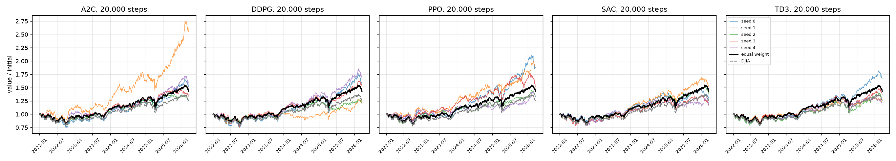
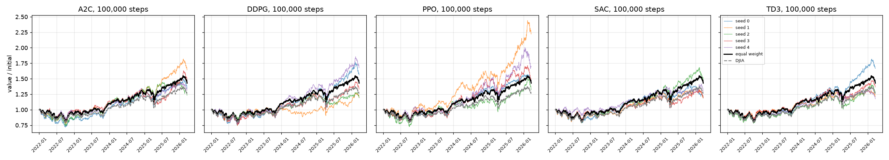
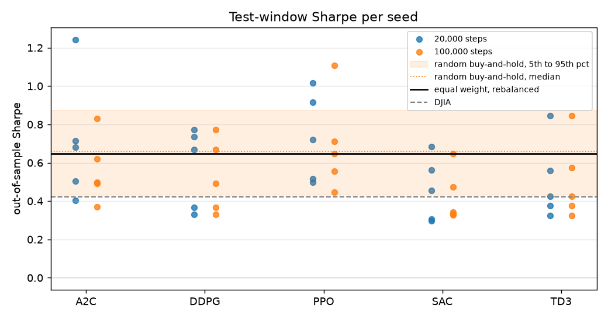
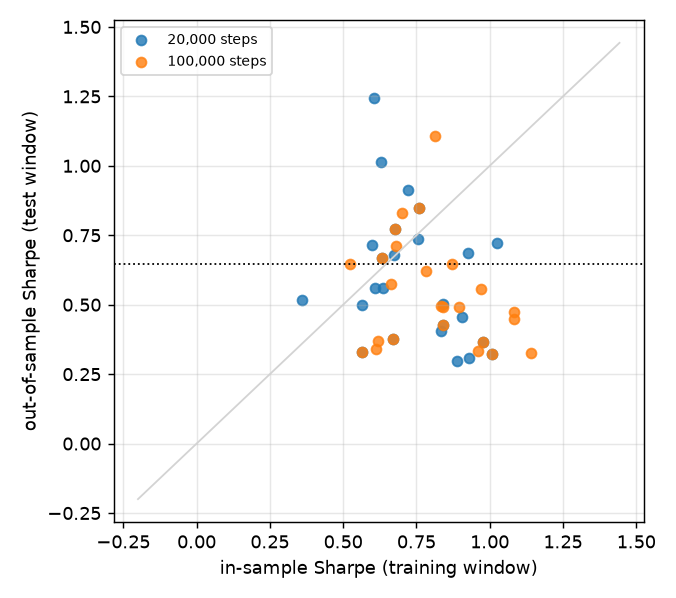

# FinRL stock-trading tutorial: out-of-sample evaluation

Universe: point-in-time Dow 30 (41 tickers over the period, 27 to 30 members per day). Training window 2014-01-06 to 2022-01-01 (2013 days), test window 2022-01-01 to 2026-03-21 (1057 days). Environment and hyperparameters as in examples/FinRL_StockTrading_2026_*.py; costs 0.1% per side; trading environment liquidates when VIX >= 70.

Constituents with no Yahoo prices for part of their membership, marked non-member on those days: DWDP (2017-09-01 to 2019-04-01), UTX (2014-01-02 to 2020-04-03), WBA (2018-06-26 to 2024-02-23).

## Baselines on the test window

|                                                    |   total_return |   cagr |   ann_vol |   sharpe |   max_drawdown |
|:---------------------------------------------------|---------------:|-------:|----------:|---------:|---------------:|
| equal weight, point-in-time Dow, rebalanced daily  |          0.429 |  0.089 |     0.149 |    0.646 |         -0.209 |
| equal weight, buy and hold from the first test day |          0.448 |  0.092 |     0.145 |    0.683 |         -0.205 |
| DJIA (price index)                                 |          0.246 |  0.054 |     0.152 |    0.421 |         -0.219 |
| cash                                               |          0.000 |  0.000 |     0.000 |    0.000 |          0.000 |

## Agents: mean over seeds (std in brackets)

|   timesteps | algo   |   n_seeds | test Sharpe   | test return   | max DD   |   train Sharpe | seeds > EW   |   pct of random |   pct of random, same #names | invested   | turnover/yr   |   eff. names | sells   |   min train |
|------------:|:-------|----------:|:--------------|:--------------|:---------|---------------:|:-------------|----------------:|-----------------------------:|:-----------|:--------------|-------------:|:--------|------------:|
|       20000 | a2c    |         5 | 0.71 (0.32)   | +64.9% (52.0) | -22.4%   |           0.71 | 3/5          |              47 |                           50 | 100%       | 0.3x          |          4.9 | 16%     |         3   |
|       20000 | ddpg   |         5 | 0.57 (0.21)   | +43.1% (22.4) | -22.7%   |           0.72 | 3/5          |              41 |                           42 | 100%       | 0.3x          |          7.5 | 7%      |         6   |
|       20000 | ppo    |         5 | 0.73 (0.23)   | +58.4% (27.5) | -18.9%   |           0.66 | 3/5          |              58 |                           60 | 96%        | 0.5x          |          4   | 34%     |         2.3 |
|       20000 | sac    |         5 | 0.46 (0.17)   | +30.4% (14.6) | -20.5%   |           0.85 | 1/5          |              17 |                           19 | 100%       | 0.3x          |          8.4 | 7%      |         6.7 |
|       20000 | td3    |         5 | 0.51 (0.21)   | +33.9% (19.7) | -19.2%   |           0.78 | 1/5          |              25 |                           24 | 100%       | 0.2x          |         10.8 | 3%      |         5.9 |
|      100000 | a2c    |         5 | 0.56 (0.17)   | +40.2% (16.0) | -22.7%   |           0.77 | 1/5          |              30 |                           32 | 100%       | 0.3x          |          7.8 | 10%     |        17   |
|      100000 | ddpg   |         5 | 0.53 (0.19)   | +39.1% (22.0) | -23.5%   |           0.74 | 2/5          |              29 |                           32 | 100%       | 0.3x          |          7.4 | 6%      |        35.8 |
|      100000 | ppo    |         5 | 0.69 (0.25)   | +62.8% (35.8) | -22.6%   |           0.88 | 3/5          |              47 |                           52 | 99%        | 0.3x          |          3.9 | 33%     |        12.5 |
|      100000 | sac    |         5 | 0.42 (0.14)   | +26.9% (12.5) | -19.3%   |           0.86 | 1/5          |              12 |                           15 | 100%       | 0.3x          |          7.5 | 17%     |        36.8 |
|      100000 | td3    |         5 | 0.51 (0.21)   | +33.8% (19.7) | -19.0%   |           0.79 | 1/5          |              25 |                           25 | 100%       | 0.2x          |         10.8 | 3%      |        34.4 |

Equal-weight (rebalanced) Sharpe on the same window: 0.65; 'seeds > EW' counts seeds whose test Sharpe exceeds it. 'pct of random' is the mean percentile of the seeds' test Sharpe within 2,000 random long-only buy-and-hold portfolios of the 29 names that were members on the first test day (null median Sharpe 0.66, 5th to 95th percentile 0.43 to 0.87; 55% of random portfolios beat the rebalanced equal-weight basket on Sharpe). 'pct of random, same #names' repeats this against 2,000 random equal-weight buy-and-hold portfolios holding exactly as many names as the run held at the end of the window, so concentration is matched. 'sells' is the share of executed trades that were sells.

## Seed-averaged series against equal weight

Daily returns averaged across seeds (what an ensemble of the seeds would earn), compared with the equal-weight basket: Sharpe difference with a stationary-bootstrap 95% interval and the Newey-West t-statistic of the daily excess return.

|   timesteps | algo   |   n_seeds |   pooled Sharpe | Sharpe diff vs EW     |   NW t |
|------------:|:-------|----------:|----------------:|:----------------------|-------:|
|       20000 | a2c    |         5 |            0.8  | +0.16  [-0.08, +0.38] |   1.46 |
|      100000 | a2c    |         5 |            0.59 | -0.05  [-0.26, +0.14] |  -0.15 |
|       20000 | ddpg   |         5 |            0.63 | -0.01  [-0.21, +0.18] |   0.05 |
|      100000 | ddpg   |         5 |            0.59 | -0.06  [-0.25, +0.13] |  -0.32 |
|       20000 | ppo    |         5 |            0.85 | +0.20  [-0.13, +0.52] |   1    |
|      100000 | ppo    |         5 |            0.76 | +0.11  [-0.19, +0.40] |   1.13 |
|       20000 | sac    |         5 |            0.5  | -0.15  [-0.50, +0.18] |  -0.8  |
|      100000 | sac    |         5 |            0.46 | -0.19  [-0.52, +0.13] |  -1.15 |
|       20000 | td3    |         5 |            0.53 | -0.12  [-0.42, +0.15] |  -0.72 |
|      100000 | td3    |         5 |            0.53 | -0.12  [-0.42, +0.16] |  -0.73 |

## What this test window can detect

The bootstrap standard error of a single run's Sharpe difference against equal weight averages 0.22. At 80% power and a two-sided 5% level, the smallest Sharpe improvement this window can establish is about 0.62; anything smaller than that is indistinguishable from noise with 1057 test days, whatever the point estimate says.

## Figures

## Per-run table

|   timesteps | algo   |   seed |   test_sharpe |   test_total_return |   test_max_drawdown |   train_sharpe |   sharpe_diff_vs_ew |   sharpe_diff_ci_low |   sharpe_diff_ci_high |   excess_nw_t |   null_percentile |   null_percentile_matched |   invested_frac_mean |   days_with_trades_frac |   sell_share_of_trades |   annual_turnover |   names_held_end |   effective_names_end | top_holding_end   |
|------------:|:-------|-------:|--------------:|--------------------:|--------------------:|---------------:|--------------------:|---------------------:|----------------------:|--------------:|------------------:|--------------------------:|---------------------:|------------------------:|-----------------------:|------------------:|-----------------:|----------------------:|:------------------|
|       20000 | a2c    |      0 |         0.680 |               0.523 |              -0.260 |          0.675 |               0.033 |               -0.372 |                 0.425 |         0.546 |             0.547 |                     0.587 |                1.002 |                   0.027 |                  0.297 |             0.562 |               11 |                 5.921 | CAT 33%           |
|       20000 | a2c    |      1 |         1.243 |               1.547 |              -0.219 |          0.604 |               0.596 |               -0.106 |                 1.265 |         2.363 |             1.000 |                     0.999 |                0.991 |                   0.024 |                  0.034 |             0.178 |                8 |                 2.778 | CAT 53%           |
|       20000 | a2c    |      2 |         0.404 |               0.249 |              -0.215 |          0.835 |              -0.243 |               -0.624 |                 0.085 |        -0.939 |             0.033 |                     0.097 |                0.998 |                   0.013 |                  0.092 |             0.287 |               12 |                 6.373 | V 28%             |
|       20000 | a2c    |      3 |         0.504 |               0.338 |              -0.229 |          0.839 |              -0.142 |               -0.579 |                 0.251 |        -0.381 |             0.130 |                     0.179 |                1.000 |                   0.022 |                  0.205 |             0.309 |               13 |                 5.542 | V 27%             |
|       20000 | a2c    |      4 |         0.716 |               0.586 |              -0.196 |          0.599 |               0.069 |               -0.329 |                 0.473 |         0.723 |             0.636 |                     0.653 |                0.997 |                   0.024 |                  0.180 |             0.370 |               11 |                 4.066 | GS 35%            |
|       20000 | ddpg   |      0 |         0.669 |               0.560 |              -0.258 |          0.633 |               0.023 |               -0.281 |                 0.321 |         0.779 |             0.521 |                     0.520 |                1.004 |                   0.012 |                  0.074 |             0.229 |               14 |                 8.953 | GS 20%            |
|       20000 | ddpg   |      1 |         0.330 |               0.192 |              -0.258 |          0.564 |              -0.316 |               -0.892 |                 0.215 |        -0.845 |             0.011 |                     0.100 |                1.010 |                   0.018 |                  0.165 |             0.423 |                8 |                 5.470 | CVX 25%           |
|       20000 | ddpg   |      2 |         0.367 |               0.195 |              -0.160 |          0.975 |              -0.279 |               -0.841 |                 0.229 |        -1.064 |             0.021 |                     0.033 |                0.998 |                   0.009 |                  0.049 |             0.267 |               14 |                 9.096 | TRV 22%           |
|       20000 | ddpg   |      3 |         0.735 |               0.529 |              -0.210 |          0.755 |               0.089 |               -0.241 |                 0.430 |         0.672 |             0.689 |                     0.695 |                1.006 |                   0.012 |                  0.055 |             0.229 |               13 |                 8.321 | CAT 22%           |
|       20000 | ddpg   |      4 |         0.772 |               0.678 |              -0.250 |          0.676 |               0.126 |               -0.255 |                 0.495 |         1.222 |             0.789 |                     0.752 |                1.002 |                   0.009 |                  0.000 |             0.210 |               10 |                 5.521 | CAT 32%           |
|       20000 | ppo    |      0 |         0.914 |               0.880 |              -0.213 |          0.720 |               0.268 |               -0.205 |                 0.709 |         1.510 |             0.979 |                     0.947 |                0.977 |                   0.506 |                  0.401 |             0.453 |               12 |                 2.196 | GS 64%            |
|       20000 | ppo    |      1 |         1.015 |               0.868 |              -0.139 |          0.630 |               0.369 |               -0.343 |                 1.004 |         1.184 |             0.998 |                     0.990 |                0.960 |                   0.572 |                  0.313 |             0.403 |               11 |                 2.639 | TRV 53%           |
|       20000 | ppo    |      2 |         0.499 |               0.331 |              -0.230 |          0.564 |              -0.147 |               -0.594 |                 0.278 |        -0.390 |             0.119 |                     0.157 |                0.985 |                   0.940 |                  0.391 |             0.701 |               14 |                 6.852 | JNJ 22%           |
|       20000 | ppo    |      3 |         0.722 |               0.511 |              -0.189 |          1.023 |               0.076 |               -0.531 |                 0.641 |         0.308 |             0.650 |                     0.664 |                0.908 |                   0.749 |                  0.312 |             0.513 |               10 |                 4.007 | BA 41%            |
|       20000 | ppo    |      4 |         0.518 |               0.329 |              -0.173 |          0.358 |              -0.129 |               -0.809 |                 0.501 |        -0.347 |             0.145 |                     0.259 |                0.959 |                   0.376 |                  0.285 |             0.414 |               11 |                 4.190 | AMGN 35%          |
|       20000 | sac    |      0 |         0.456 |               0.292 |              -0.184 |          0.904 |              -0.191 |               -0.706 |                 0.298 |        -0.582 |             0.068 |                     0.066 |                0.996 |                   0.010 |                  0.000 |             0.210 |               15 |                 7.936 | MSFT 20%          |
|       20000 | sac    |      1 |         0.685 |               0.513 |              -0.185 |          0.924 |               0.038 |               -0.275 |                 0.315 |         0.572 |             0.561 |                     0.564 |                0.996 |                   0.009 |                  0.000 |             0.202 |               14 |                 8.311 | GS 21%            |
|       20000 | sac    |      2 |         0.562 |               0.378 |              -0.208 |          0.607 |              -0.084 |               -0.362 |                 0.186 |        -0.349 |             0.230 |                     0.115 |                0.998 |                   0.008 |                  0.000 |             0.214 |               21 |                14.854 | AMGN 9%           |
|       20000 | sac    |      3 |         0.297 |               0.164 |              -0.217 |          0.888 |              -0.349 |               -0.854 |                 0.111 |        -1.157 |             0.006 |                     0.001 |                0.999 |                   0.008 |                  0.000 |             0.226 |               18 |                 9.041 | MSFT 19%          |
|       20000 | sac    |      4 |         0.307 |               0.176 |              -0.230 |          0.931 |              -0.340 |               -1.066 |                 0.351 |        -0.659 |             0.007 |                     0.203 |                0.993 |                   0.296 |                  0.368 |             0.499 |                4 |                 1.805 | PG 69%            |
|       20000 | td3    |      0 |         0.847 |               0.666 |              -0.210 |          0.758 |               0.200 |               -0.078 |                 0.507 |         1.665 |             0.926 |                     0.916 |                1.001 |                   0.009 |                  0.090 |             0.301 |               15 |                10.650 | CAT 16%           |
|       20000 | td3    |      1 |         0.376 |               0.211 |              -0.170 |          0.669 |              -0.271 |               -0.774 |                 0.145 |        -1.165 |             0.024 |                     0.043 |                1.002 |                   0.007 |                  0.000 |             0.222 |               13 |                10.523 | TRV 12%           |
|       20000 | td3    |      2 |         0.426 |               0.272 |              -0.223 |          0.840 |              -0.220 |               -0.587 |                 0.142 |        -0.818 |             0.047 |                     0.031 |                1.003 |                   0.005 |                  0.000 |             0.234 |               17 |                10.192 | GS 18%            |
|       20000 | td3    |      3 |         0.559 |               0.370 |              -0.185 |          0.635 |              -0.087 |               -0.426 |                 0.235 |        -0.321 |             0.225 |                     0.189 |                0.999 |                   0.005 |                  0.000 |             0.214 |               17 |                11.356 | CAT 20%           |
|       20000 | td3    |      4 |         0.324 |               0.175 |              -0.172 |          1.007 |              -0.322 |               -0.795 |                 0.119 |        -1.198 |             0.009 |                     0.020 |                1.002 |                   0.009 |                  0.049 |             0.259 |               14 |                11.100 | MSFT 13%          |
|      100000 | a2c    |      0 |         0.492 |               0.345 |              -0.284 |          0.894 |              -0.154 |               -0.487 |                 0.159 |        -0.337 |             0.105 |                     0.110 |                1.002 |                   0.007 |                  0.024 |             0.246 |               16 |                 8.024 | CAT 25%           |
|      100000 | a2c    |      1 |         0.830 |               0.641 |              -0.231 |          0.702 |               0.184 |               -0.106 |                 0.466 |         1.421 |             0.902 |                     0.895 |                1.001 |                   0.006 |                  0.000 |             0.209 |               15 |                 9.345 | GS 19%            |
|      100000 | a2c    |      2 |         0.369 |               0.233 |              -0.260 |          0.619 |              -0.278 |               -0.803 |                 0.140 |        -0.774 |             0.021 |                     0.034 |                1.002 |                   0.014 |                  0.108 |             0.268 |               14 |                 6.557 | V 29%             |
|      100000 | a2c    |      3 |         0.620 |               0.477 |              -0.201 |          0.783 |              -0.027 |               -0.562 |                 0.460 |         0.256 |             0.379 |                     0.450 |                1.004 |                   0.042 |                  0.377 |             0.527 |               12 |                 4.217 | CAT 45%           |
|      100000 | a2c    |      4 |         0.497 |               0.312 |              -0.159 |          0.834 |              -0.149 |               -0.537 |                 0.211 |        -0.696 |             0.116 |                     0.119 |                1.000 |                   0.005 |                  0.000 |             0.216 |               15 |                10.722 | GS 18%            |
|      100000 | ddpg   |      0 |         0.669 |               0.560 |              -0.258 |          0.633 |               0.023 |               -0.281 |                 0.321 |         0.779 |             0.521 |                     0.520 |                1.004 |                   0.012 |                  0.074 |             0.229 |               14 |                 8.953 | GS 20%            |
|      100000 | ddpg   |      1 |         0.330 |               0.192 |              -0.258 |          0.564 |              -0.316 |               -0.892 |                 0.215 |        -0.845 |             0.011 |                     0.100 |                1.010 |                   0.018 |                  0.165 |             0.423 |                8 |                 5.470 | CVX 25%           |
|      100000 | ddpg   |      2 |         0.367 |               0.195 |              -0.160 |          0.975 |              -0.279 |               -0.841 |                 0.229 |        -1.064 |             0.021 |                     0.033 |                0.998 |                   0.009 |                  0.049 |             0.267 |               14 |                 9.096 | TRV 22%           |
|      100000 | ddpg   |      3 |         0.491 |               0.332 |              -0.248 |          0.841 |              -0.155 |               -0.442 |                 0.118 |        -0.500 |             0.105 |                     0.206 |                1.002 |                   0.007 |                  0.000 |             0.232 |               12 |                 7.839 | CAT 25%           |
|      100000 | ddpg   |      4 |         0.772 |               0.678 |              -0.250 |          0.676 |               0.126 |               -0.255 |                 0.495 |         1.222 |             0.789 |                     0.752 |                1.002 |                   0.009 |                  0.000 |             0.210 |               10 |                 5.521 | CAT 32%           |
|      100000 | ppo    |      0 |         0.646 |               0.442 |              -0.208 |          0.870 |               0.000 |               -0.326 |                 0.297 |         0.111 |             0.455 |                     0.462 |                0.995 |                   0.356 |                  0.390 |             0.289 |               14 |                 7.728 | GS 21%            |
|      100000 | ppo    |      1 |         1.106 |               1.221 |              -0.211 |          0.814 |               0.460 |               -0.073 |                 0.976 |         2.286 |             1.000 |                     0.990 |                0.983 |                   0.434 |                  0.418 |             0.319 |                8 |                 2.583 | CAT 56%           |
|      100000 | ppo    |      2 |         0.447 |               0.320 |              -0.276 |          1.081 |              -0.199 |               -0.676 |                 0.235 |        -0.273 |             0.063 |                     0.104 |                0.999 |                   0.389 |                  0.359 |             0.355 |               13 |                 4.672 | CAT 36%           |
|      100000 | ppo    |      3 |         0.557 |               0.463 |              -0.208 |          0.969 |              -0.089 |               -0.587 |                 0.372 |         0.257 |             0.220 |                     0.381 |                0.988 |                   0.331 |                  0.303 |             0.423 |                8 |                 2.587 | HD 48%            |
|      100000 | ppo    |      4 |         0.710 |               0.694 |              -0.225 |          0.682 |               0.064 |               -0.472 |                 0.588 |         0.909 |             0.625 |                     0.639 |                0.993 |                   0.075 |                  0.179 |             0.274 |               13 |                 1.914 | GS 71%            |
|      100000 | sac    |      0 |         0.327 |               0.189 |              -0.212 |          1.140 |              -0.319 |               -0.900 |                 0.225 |        -0.890 |             0.011 |                     0.048 |                0.999 |                   0.045 |                  0.275 |             0.333 |               11 |                 5.432 | MSFT 35%          |
|      100000 | sac    |      1 |         0.334 |               0.187 |              -0.200 |          0.959 |              -0.312 |               -0.764 |                 0.043 |        -1.310 |             0.013 |                     0.012 |                1.001 |                   0.005 |                  0.000 |             0.226 |               15 |                 8.910 | GS 22%            |
|      100000 | sac    |      2 |         0.646 |               0.476 |              -0.220 |          0.523 |               0.000 |               -0.337 |                 0.304 |         0.352 |             0.455 |                     0.456 |                1.012 |                   0.081 |                  0.265 |             0.367 |               15 |                 8.932 | IBM 20%           |
|      100000 | sac    |      3 |         0.342 |               0.193 |              -0.183 |          0.611 |              -0.305 |               -0.720 |                 0.087 |        -1.311 |             0.015 |                     0.013 |                1.002 |                   0.007 |                  0.000 |             0.228 |               15 |                11.122 | AXP 15%           |
|      100000 | sac    |      4 |         0.475 |               0.299 |              -0.152 |          1.084 |              -0.171 |               -0.850 |                 0.414 |        -0.397 |             0.091 |                     0.231 |                0.999 |                   0.173 |                  0.309 |             0.577 |                9 |                 3.148 | V 40%             |
|      100000 | td3    |      0 |         0.847 |               0.666 |              -0.210 |          0.758 |               0.200 |               -0.078 |                 0.507 |         1.665 |             0.926 |                     0.916 |                1.001 |                   0.009 |                  0.090 |             0.301 |               15 |                10.650 | CAT 16%           |
|      100000 | td3    |      1 |         0.376 |               0.211 |              -0.170 |          0.669 |              -0.271 |               -0.774 |                 0.145 |        -1.165 |             0.024 |                     0.043 |                1.002 |                   0.007 |                  0.000 |             0.222 |               13 |                10.523 | TRV 12%           |
|      100000 | td3    |      2 |         0.426 |               0.272 |              -0.223 |          0.840 |              -0.220 |               -0.587 |                 0.142 |        -0.818 |             0.047 |                     0.031 |                1.003 |                   0.005 |                  0.000 |             0.234 |               17 |                10.192 | GS 18%            |
|      100000 | td3    |      3 |         0.575 |               0.366 |              -0.171 |          0.664 |              -0.072 |               -0.438 |                 0.253 |        -0.375 |             0.257 |                     0.215 |                0.999 |                   0.004 |                  0.000 |             0.213 |               17 |                11.678 | CAT 19%           |
|      100000 | td3    |      4 |         0.324 |               0.175 |              -0.172 |          1.007 |              -0.322 |               -0.795 |                 0.119 |        -1.198 |             0.009 |                     0.020 |                1.002 |                   0.009 |                  0.049 |             0.259 |               14 |                11.100 | MSFT 13%          |
