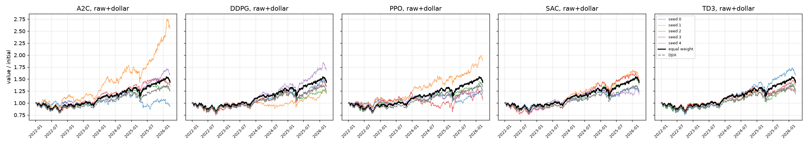
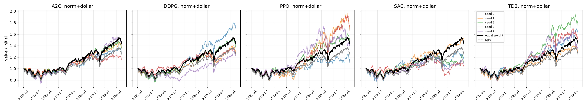
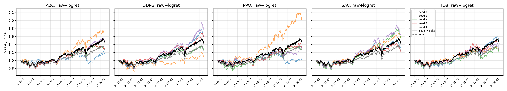
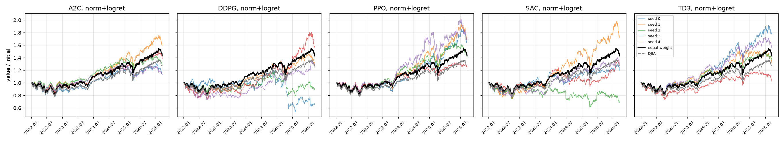
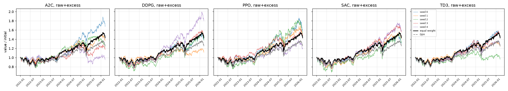
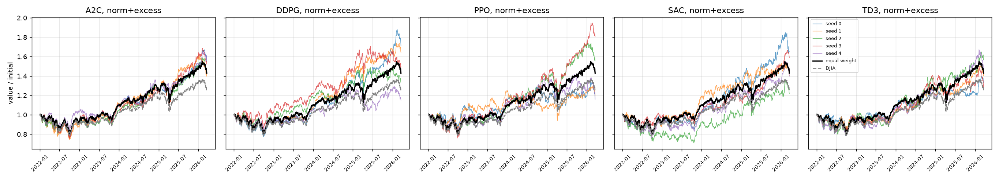
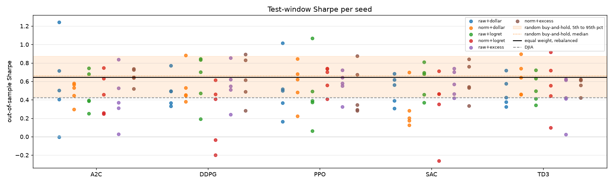
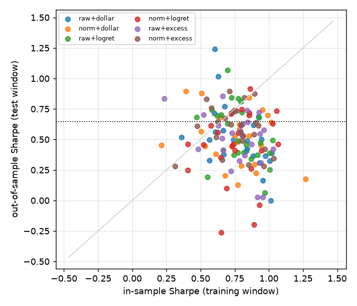

# FinRL stock-trading tutorial: out-of-sample evaluation

Universe: point-in-time Dow 30 (41 tickers over the period, 27 to 30 members per day). Training window 2014-01-06 to 2022-01-01 (2013 days), test window 2022-01-01 to 2026-03-21 (1057 days). Environment and hyperparameters as in examples/FinRL_StockTrading_2026_*.py; costs 0.1% per side; trading environment liquidates when VIX >= 70.

Constituents with no Yahoo prices for part of their membership, marked non-member on those days: DWDP (2017-09-01 to 2019-04-01), UTX (2014-01-02 to 2020-04-03), WBA (2018-06-26 to 2024-02-23).

## Baselines on the test window

|                                                    |   total_return |   cagr |   ann_vol |   sharpe |   max_drawdown |
|:---------------------------------------------------|---------------:|-------:|----------:|---------:|---------------:|
| equal weight, point-in-time Dow, rebalanced daily  |          0.429 |  0.089 |     0.149 |    0.646 |         -0.209 |
| equal weight, buy and hold from the first test day |          0.448 |  0.092 |     0.145 |    0.683 |         -0.205 |
| DJIA (price index)                                 |          0.246 |  0.054 |     0.152 |    0.421 |         -0.219 |
| cash                                               |          0.000 |  0.000 |     0.000 |    0.000 |          0.000 |

## Agents: mean over seeds (std in brackets)

| cell        | algo   |   n_seeds | test Sharpe   | test return   | max DD   |   train Sharpe | seeds > EW   |   pct of random |   pct of random, same #names | invested   | turnover/yr   |   eff. names | sells   |   min train |
|:------------|:-------|----------:|:--------------|:--------------|:---------|---------------:|:-------------|----------------:|-----------------------------:|:-----------|:--------------|-------------:|:--------|------------:|
| raw+dollar  | a2c    |         5 | 0.57 (0.46)   | +53.0% (61.7) | -23.6%   |           0.8  | 2/5          |              36 |                           39 | 100%       | 0.3x          |          4.5 | 21%     |         3   |
| raw+dollar  | ddpg   |         5 | 0.49 (0.17)   | +34.9% (19.8) | -22.4%   |           0.76 | 1/5          |              21 |                           26 | 100%       | 0.3x          |          7   | 6%      |         6.4 |
| raw+dollar  | ppo    |         5 | 0.51 (0.31)   | +35.5% (30.9) | -21.4%   |           0.68 | 1/5          |              26 |                           29 | 96%        | 0.5x          |          4.5 | 34%     |         2.2 |
| raw+dollar  | sac    |         5 | 0.51 (0.16)   | +34.8% (14.6) | -20.6%   |           0.87 | 1/5          |              24 |                           27 | 100%       | 0.3x          |          8.7 | 14%     |         6.6 |
| raw+dollar  | td3    |         5 | 0.48 (0.16)   | +32.1% (16.2) | -19.7%   |           0.78 | 1/5          |              20 |                           20 | 100%       | 0.2x          |         11   | 2%      |         6.3 |
| norm+dollar | a2c    |         5 | 0.48 (0.12)   | +31.1% (10.6) | -20.3%   |           0.75 | 0/5          |              15 |                           20 | 100%       | 0.2x          |          8.9 | 11%     |         3   |
| norm+dollar | ddpg   |         5 | 0.54 (0.20)   | +36.7% (19.5) | -21.3%   |           0.67 | 1/5          |              26 |                           27 | 100%       | 0.4x          |          8.6 | 13%     |         5.9 |
| norm+dollar | ppo    |         5 | 0.57 (0.23)   | +47.3% (24.9) | -20.7%   |           0.79 | 2/5          |              39 |                           44 | 97%        | 0.6x          |          2.9 | 39%     |         2.3 |
| norm+dollar | sac    |         5 | 0.30 (0.23)   | +17.0% (19.4) | -22.6%   |           0.9  | 1/5          |              12 |                           15 | 101%       | 1.0x          |          3.7 | 35%     |         6.5 |
| norm+dollar | td3    |         5 | 0.64 (0.19)   | +50.4% (18.9) | -21.4%   |           0.66 | 2/5          |              45 |                           48 | 100%       | 1.4x          |          3.9 | 24%     |         5.8 |
| raw+logret  | a2c    |         5 | 0.49 (0.21)   | +33.7% (20.3) | -22.7%   |           0.87 | 2/5          |              27 |                           29 | 100%       | 0.3x          |          6.2 | 16%     |         2.7 |
| raw+logret  | ddpg   |         5 | 0.61 (0.28)   | +46.3% (28.2) | -22.2%   |           0.73 | 3/5          |              50 |                           50 | 100%       | 0.3x          |          7.6 | 6%      |         5.4 |
| raw+logret  | ppo    |         5 | 0.48 (0.37)   | +35.3% (39.6) | -21.3%   |           0.79 | 1/5          |              23 |                           26 | 95%        | 0.6x          |          4.9 | 36%     |         1.9 |
| raw+logret  | sac    |         5 | 0.60 (0.18)   | +46.0% (18.3) | -20.9%   |           0.73 | 3/5          |              42 |                           43 | 100%       | 0.2x          |          7.2 | 10%     |         5.9 |
| raw+logret  | td3    |         5 | 0.52 (0.16)   | +34.0% (13.3) | -19.0%   |           0.81 | 1/5          |              24 |                           26 | 100%       | 0.3x          |          9.4 | 6%      |         5.3 |
| norm+logret | a2c    |         5 | 0.47 (0.22)   | +30.3% (20.0) | -18.2%   |           0.73 | 1/5          |              24 |                           25 | 100%       | 0.2x          |          8.3 | 21%     |         2.7 |
| norm+logret | ddpg   |         5 | 0.25 (0.35)   | +13.4% (36.5) | -32.8%   |           0.84 | 0/5          |               9 |                           19 | 100%       | 0.7x          |          3.9 | 25%     |         5.4 |
| norm+logret | ppo    |         5 | 0.63 (0.14)   | +53.7% (21.6) | -21.8%   |           0.85 | 3/5          |              45 |                           49 | 98%        | 0.6x          |          4.1 | 38%     |         1.9 |
| norm+logret | sac    |         5 | 0.35 (0.36)   | +24.1% (36.9) | -27.1%   |           0.63 | 1/5          |              16 |                           24 | 101%       | 0.9x          |          3.1 | 37%     |         5.7 |
| norm+logret | td3    |         5 | 0.55 (0.31)   | +40.0% (28.4) | -21.3%   |           0.78 | 2/5          |              38 |                           43 | 101%       | 0.7x          |          4.1 | 27%     |         5.2 |
| raw+excess  | a2c    |         5 | 0.41 (0.30)   | +27.9% (26.7) | -23.4%   |           0.75 | 1/5          |              22 |                           24 | 100%       | 0.4x          |          5.6 | 30%     |         2.7 |
| raw+excess  | ddpg   |         5 | 0.55 (0.22)   | +42.4% (24.6) | -23.3%   |           0.75 | 1/5          |              33 |                           35 | 100%       | 0.2x          |          8.4 | 3%      |         5.2 |
| raw+excess  | ppo    |         5 | 0.56 (0.15)   | +43.6% (15.4) | -20.9%   |           0.85 | 1/5          |              32 |                           33 | 99%        | 0.5x          |          4.6 | 37%     |         1.9 |
| raw+excess  | sac    |         5 | 0.58 (0.14)   | +43.2% (12.6) | -24.1%   |           0.7  | 2/5          |              33 |                           36 | 100%       | 0.3x          |          7   | 16%     |         5.6 |
| raw+excess  | td3    |         5 | 0.42 (0.24)   | +26.7% (19.7) | -18.9%   |           0.81 | 0/5          |              17 |                           17 | 100%       | 0.2x          |         10.3 | 4%      |         5.1 |
| norm+excess | a2c    |         5 | 0.65 (0.09)   | +49.3% (6.8)  | -23.0%   |           0.73 | 2/5          |              47 |                           49 | 100%       | 0.3x          |          6.6 | 27%     |         3.1 |
| norm+excess | ddpg   |         5 | 0.62 (0.25)   | +46.8% (22.8) | -20.0%   |           0.66 | 2/5          |              47 |                           53 | 100%       | 0.6x          |          4.3 | 22%     |         6.1 |
| norm+excess | ppo    |         5 | 0.49 (0.27)   | +37.7% (29.3) | -21.8%   |           0.88 | 2/5          |              30 |                           33 | 99%        | 0.8x          |          4.7 | 42%     |         2.4 |
| norm+excess | sac    |         5 | 0.60 (0.20)   | +45.2% (17.1) | -22.4%   |           0.75 | 2/5          |              41 |                           48 | 101%       | 1.0x          |          3   | 38%     |         6.7 |
| norm+excess | td3    |         5 | 0.57 (0.08)   | +41.0% (11.2) | -19.2%   |           0.75 | 0/5          |              27 |                           39 | 100%       | 1.0x          |          3.8 | 27%     |         6   |

Equal-weight (rebalanced) Sharpe on the same window: 0.65; 'seeds > EW' counts seeds whose test Sharpe exceeds it. 'pct of random' is the mean percentile of the seeds' test Sharpe within 2,000 random long-only buy-and-hold portfolios of the 29 names that were members on the first test day (null median Sharpe 0.66, 5th to 95th percentile 0.43 to 0.87; 55% of random portfolios beat the rebalanced equal-weight basket on Sharpe). 'pct of random, same #names' repeats this against 2,000 random equal-weight buy-and-hold portfolios holding exactly as many names as the run held at the end of the window, so concentration is matched. 'sells' is the share of executed trades that were sells.

## Seed-averaged series against equal weight

Daily returns averaged across seeds (what an ensemble of the seeds would earn), compared with the equal-weight basket: Sharpe difference with a stationary-bootstrap 95% interval and the Newey-West t-statistic of the daily excess return.

| cell        | algo   |   n_seeds |   pooled Sharpe | Sharpe diff vs EW     |   NW t |
|:------------|:-------|----------:|----------------:|:----------------------|-------:|
| raw+dollar  | a2c    |         5 |            0.68 | +0.03  [-0.23, +0.27] |   0.36 |
| raw+dollar  | ddpg   |         5 |            0.55 | -0.10  [-0.32, +0.13] |  -0.71 |
| raw+dollar  | ppo    |         5 |            0.6  | -0.05  [-0.49, +0.34] |  -0.49 |
| raw+dollar  | sac    |         5 |            0.56 | -0.09  [-0.39, +0.21] |  -0.57 |
| raw+dollar  | td3    |         5 |            0.51 | -0.14  [-0.46, +0.13] |  -0.81 |
| norm+dollar | a2c    |         5 |            0.52 | -0.13  [-0.33, +0.03] |  -1.38 |
| norm+dollar | ddpg   |         5 |            0.58 | -0.06  [-0.26, +0.12] |  -0.71 |
| norm+dollar | ppo    |         5 |            0.65 | -0.00  [-0.33, +0.30] |   0.38 |
| norm+dollar | sac    |         5 |            0.35 | -0.30  [-0.88, +0.19] |  -1.36 |
| norm+dollar | td3    |         5 |            0.71 | +0.07  [-0.31, +0.42] |   0.55 |
| raw+logret  | a2c    |         5 |            0.55 | -0.10  [-0.35, +0.10] |  -0.8  |
| raw+logret  | ddpg   |         5 |            0.68 | +0.03  [-0.17, +0.23] |   0.26 |
| raw+logret  | ppo    |         5 |            0.57 | -0.07  [-0.38, +0.19] |  -0.81 |
| raw+logret  | sac    |         5 |            0.63 | -0.01  [-0.34, +0.26] |   0.31 |
| raw+logret  | td3    |         5 |            0.54 | -0.10  [-0.44, +0.20] |  -0.63 |
| norm+logret | a2c    |         5 |            0.49 | -0.16  [-0.52, +0.15] |  -0.91 |
| norm+logret | ddpg   |         5 |            0.25 | -0.40  [-1.08, +0.17] |  -1.09 |
| norm+logret | ppo    |         5 |            0.69 | +0.05  [-0.27, +0.36] |   0.74 |
| norm+logret | sac    |         5 |            0.39 | -0.26  [-0.58, +0.02] |  -1.56 |
| norm+logret | td3    |         5 |            0.6  | -0.05  [-0.38, +0.22] |  -0.29 |
| raw+excess  | a2c    |         5 |            0.46 | -0.18  [-0.68, +0.24] |  -0.8  |
| raw+excess  | ddpg   |         5 |            0.6  | -0.04  [-0.26, +0.18] |  -0    |
| raw+excess  | ppo    |         5 |            0.61 | -0.04  [-0.38, +0.28] |   0.21 |
| raw+excess  | sac    |         5 |            0.6  | -0.04  [-0.35, +0.25] |   0.18 |
| raw+excess  | td3    |         5 |            0.43 | -0.21  [-0.61, +0.13] |  -1.09 |
| norm+excess | a2c    |         5 |            0.7  | +0.05  [-0.15, +0.23] |   0.77 |
| norm+excess | ddpg   |         5 |            0.68 | +0.03  [-0.32, +0.35] |   0.27 |
| norm+excess | ppo    |         5 |            0.56 | -0.09  [-0.35, +0.16] |  -0.36 |
| norm+excess | sac    |         5 |            0.68 | +0.03  [-0.26, +0.31] |   0.34 |
| norm+excess | td3    |         5 |            0.67 | +0.02  [-0.37, +0.36] |  -0.01 |

## What this test window can detect

The bootstrap standard error of a single run's Sharpe difference against equal weight averages 0.25. At 80% power and a two-sided 5% level, the smallest Sharpe improvement this window can establish is about 0.70; anything smaller than that is indistinguishable from noise with 1057 test days, whatever the point estimate says.

## Figures

## Per-run table

| cell        | algo   |   seed |   test_sharpe |   test_total_return |   test_max_drawdown |   train_sharpe |   sharpe_diff_vs_ew |   sharpe_diff_ci_low |   sharpe_diff_ci_high |   excess_nw_t |   null_percentile |   null_percentile_matched |   invested_frac_mean |   days_with_trades_frac |   sell_share_of_trades |   annual_turnover |   names_held_end |   effective_names_end | top_holding_end   |
|:------------|:-------|-------:|--------------:|--------------------:|--------------------:|---------------:|--------------------:|---------------------:|----------------------:|--------------:|------------------:|--------------------------:|---------------------:|------------------------:|-----------------------:|------------------:|-----------------:|----------------------:|:------------------|
| raw+dollar  | a2c    |      0 |        -0.002 |              -0.081 |              -0.323 |          1.012 |              -0.649 |               -1.590 |                 0.253 |        -1.167 |             0.000 |                     0.006 |                0.998 |                   0.240 |                  0.428 |             0.382 |                7 |                 4.482 | UNH 36%           |
| raw+dollar  | a2c    |      1 |         1.243 |               1.547 |              -0.219 |          0.604 |               0.596 |               -0.106 |                 1.265 |         2.363 |             1.000 |                     0.999 |                0.991 |                   0.024 |                  0.034 |             0.178 |                8 |                 2.778 | CAT 53%           |
| raw+dollar  | a2c    |      2 |         0.404 |               0.249 |              -0.215 |          0.835 |              -0.243 |               -0.624 |                 0.085 |        -0.939 |             0.033 |                     0.097 |                0.998 |                   0.013 |                  0.092 |             0.287 |               12 |                 6.373 | V 28%             |
| raw+dollar  | a2c    |      3 |         0.501 |               0.350 |              -0.226 |          0.946 |              -0.145 |               -0.606 |                 0.279 |        -0.254 |             0.124 |                     0.174 |                1.002 |                   0.098 |                  0.300 |             0.343 |               13 |                 4.636 | V 38%             |
| raw+dollar  | a2c    |      4 |         0.716 |               0.586 |              -0.196 |          0.599 |               0.069 |               -0.329 |                 0.473 |         0.723 |             0.636 |                     0.653 |                0.997 |                   0.024 |                  0.180 |             0.370 |               11 |                 4.066 | GS 35%            |
| raw+dollar  | ddpg   |      0 |         0.497 |               0.349 |              -0.205 |          0.742 |              -0.150 |               -0.603 |                 0.282 |        -0.239 |             0.116 |                     0.226 |                1.001 |                   0.012 |                  0.083 |             0.233 |               11 |                 7.123 | GS 24%            |
| raw+dollar  | ddpg   |      1 |         0.330 |               0.192 |              -0.258 |          0.564 |              -0.316 |               -0.892 |                 0.215 |        -0.845 |             0.011 |                     0.100 |                1.010 |                   0.018 |                  0.165 |             0.423 |                8 |                 5.470 | CVX 25%           |
| raw+dollar  | ddpg   |      2 |         0.367 |               0.195 |              -0.160 |          0.975 |              -0.279 |               -0.841 |                 0.229 |        -1.064 |             0.021 |                     0.033 |                0.998 |                   0.009 |                  0.049 |             0.267 |               14 |                 9.096 | TRV 22%           |
| raw+dollar  | ddpg   |      3 |         0.491 |               0.332 |              -0.248 |          0.841 |              -0.155 |               -0.442 |                 0.118 |        -0.500 |             0.105 |                     0.206 |                1.002 |                   0.007 |                  0.000 |             0.232 |               12 |                 7.839 | CAT 25%           |
| raw+dollar  | ddpg   |      4 |         0.772 |               0.678 |              -0.250 |          0.676 |               0.126 |               -0.255 |                 0.495 |         1.222 |             0.789 |                     0.752 |                1.002 |                   0.009 |                  0.000 |             0.210 |               10 |                 5.521 | CAT 32%           |
| raw+dollar  | ppo    |      0 |         0.367 |               0.189 |              -0.191 |          0.885 |              -0.280 |               -1.213 |                 0.590 |        -0.716 |             0.021 |                     0.038 |                0.966 |                   0.605 |                  0.357 |             0.484 |               13 |                 6.677 | JNJ 28%           |
| raw+dollar  | ppo    |      1 |         1.015 |               0.868 |              -0.139 |          0.630 |               0.369 |               -0.343 |                 1.004 |         1.184 |             0.998 |                     0.990 |                0.960 |                   0.572 |                  0.313 |             0.403 |               11 |                 2.639 | TRV 53%           |
| raw+dollar  | ppo    |      2 |         0.499 |               0.331 |              -0.230 |          0.564 |              -0.147 |               -0.594 |                 0.278 |        -0.390 |             0.119 |                     0.157 |                0.985 |                   0.940 |                  0.391 |             0.701 |               14 |                 6.852 | JNJ 22%           |
| raw+dollar  | ppo    |      3 |         0.165 |               0.055 |              -0.338 |          0.954 |              -0.481 |               -1.321 |                 0.264 |        -0.857 |             0.000 |                     0.018 |                0.945 |                   0.719 |                  0.358 |             0.552 |                8 |                 2.277 | BA 63%            |
| raw+dollar  | ppo    |      4 |         0.518 |               0.329 |              -0.173 |          0.358 |              -0.129 |               -0.809 |                 0.501 |        -0.347 |             0.145 |                     0.259 |                0.959 |                   0.376 |                  0.285 |             0.414 |               11 |                 4.190 | AMGN 35%          |
| raw+dollar  | sac    |      0 |         0.390 |               0.220 |              -0.163 |          1.021 |              -0.256 |               -0.842 |                 0.277 |        -0.959 |             0.029 |                     0.025 |                0.998 |                   0.009 |                  0.000 |             0.222 |               16 |                10.897 | UNH 13%           |
| raw+dollar  | sac    |      1 |         0.685 |               0.513 |              -0.185 |          0.924 |               0.038 |               -0.275 |                 0.315 |         0.572 |             0.561 |                     0.564 |                0.996 |                   0.009 |                  0.000 |             0.202 |               14 |                 8.311 | GS 21%            |
| raw+dollar  | sac    |      2 |         0.562 |               0.378 |              -0.208 |          0.607 |              -0.084 |               -0.362 |                 0.186 |        -0.349 |             0.230 |                     0.115 |                0.998 |                   0.008 |                  0.000 |             0.214 |               21 |                14.854 | AMGN 9%           |
| raw+dollar  | sac    |      3 |         0.617 |               0.453 |              -0.244 |          0.887 |              -0.030 |               -0.427 |                 0.355 |         0.214 |             0.368 |                     0.463 |                0.996 |                   0.085 |                  0.323 |             0.262 |               10 |                 7.663 | AXP 18%           |
| raw+dollar  | sac    |      4 |         0.307 |               0.176 |              -0.230 |          0.931 |              -0.340 |               -1.066 |                 0.351 |        -0.659 |             0.007 |                     0.203 |                0.993 |                   0.296 |                  0.368 |             0.499 |                4 |                 1.805 | PG 69%            |
| raw+dollar  | td3    |      0 |         0.720 |               0.580 |              -0.247 |          0.728 |               0.073 |               -0.178 |                 0.312 |         1.020 |             0.643 |                     0.676 |                1.001 |                   0.008 |                  0.039 |             0.261 |               18 |                11.752 | GS 15%            |
| raw+dollar  | td3    |      1 |         0.376 |               0.211 |              -0.170 |          0.669 |              -0.271 |               -0.774 |                 0.145 |        -1.165 |             0.024 |                     0.043 |                1.002 |                   0.007 |                  0.000 |             0.222 |               13 |                10.523 | TRV 12%           |
| raw+dollar  | td3    |      2 |         0.426 |               0.272 |              -0.223 |          0.840 |              -0.220 |               -0.587 |                 0.142 |        -0.818 |             0.047 |                     0.031 |                1.003 |                   0.005 |                  0.000 |             0.234 |               17 |                10.192 | GS 18%            |
| raw+dollar  | td3    |      3 |         0.575 |               0.366 |              -0.171 |          0.664 |              -0.072 |               -0.438 |                 0.253 |        -0.375 |             0.257 |                     0.215 |                0.999 |                   0.004 |                  0.000 |             0.213 |               17 |                11.678 | CAT 19%           |
| raw+dollar  | td3    |      4 |         0.324 |               0.175 |              -0.172 |          1.007 |              -0.322 |               -0.795 |                 0.119 |        -1.198 |             0.009 |                     0.020 |                1.002 |                   0.009 |                  0.049 |             0.259 |               14 |                11.100 | MSFT 13%          |
| norm+dollar | a2c    |      0 |         0.446 |               0.264 |              -0.217 |          0.728 |              -0.200 |               -0.502 |                 0.070 |        -1.264 |             0.062 |                     0.061 |                1.001 |                   0.008 |                  0.000 |             0.226 |               15 |                10.514 | V 15%             |
| norm+dollar | a2c    |      1 |         0.581 |               0.367 |              -0.194 |          0.785 |              -0.066 |               -0.400 |                 0.225 |        -0.414 |             0.272 |                     0.281 |                1.001 |                   0.007 |                  0.000 |             0.218 |               16 |                10.738 | V 14%             |
| norm+dollar | a2c    |      2 |         0.529 |               0.353 |              -0.185 |          0.855 |              -0.117 |               -0.453 |                 0.185 |        -0.412 |             0.164 |                     0.287 |                0.997 |                   0.008 |                  0.000 |             0.213 |               10 |                 8.229 | V 17%             |
| norm+dollar | a2c    |      3 |         0.298 |               0.152 |              -0.159 |          0.895 |              -0.348 |               -0.870 |                 0.101 |        -1.256 |             0.006 |                     0.032 |                0.998 |                   0.057 |                  0.273 |             0.288 |               11 |                 7.878 | MSFT 20%          |
| norm+dollar | a2c    |      4 |         0.564 |               0.422 |              -0.260 |          0.502 |              -0.082 |               -0.385 |                 0.197 |         0.105 |             0.237 |                     0.336 |                0.997 |                   0.096 |                  0.291 |             0.241 |               12 |                 7.116 | CAT 20%           |
| norm+dollar | ddpg   |      0 |         0.881 |               0.702 |              -0.230 |          0.507 |               0.235 |               -0.208 |                 0.657 |         1.196 |             0.959 |                     0.911 |                0.999 |                   0.035 |                  0.209 |             0.419 |               11 |                 4.551 | TRV 38%           |
| norm+dollar | ddpg   |      1 |         0.454 |               0.282 |              -0.191 |          0.941 |              -0.192 |               -0.646 |                 0.230 |        -0.758 |             0.067 |                     0.065 |                0.999 |                   0.009 |                  0.068 |             0.263 |               15 |                 9.993 | GS 19%            |
| norm+dollar | ddpg   |      2 |         0.530 |               0.371 |              -0.250 |          0.752 |              -0.116 |               -0.380 |                 0.118 |        -0.304 |             0.169 |                     0.175 |                1.001 |                   0.009 |                  0.052 |             0.243 |               16 |                11.029 | V 15%             |
| norm+dollar | ddpg   |      3 |         0.446 |               0.255 |              -0.159 |          0.532 |              -0.200 |               -0.693 |                 0.227 |        -0.853 |             0.062 |                     0.102 |                0.998 |                   0.009 |                  0.068 |             0.222 |               13 |                10.404 | TRV 15%           |
| norm+dollar | ddpg   |      4 |         0.381 |               0.227 |              -0.233 |          0.612 |              -0.265 |               -0.704 |                 0.113 |        -0.994 |             0.026 |                     0.077 |                1.002 |                   0.071 |                  0.240 |             0.782 |               12 |                 6.852 | DIS 19%           |
| norm+dollar | ppo    |      0 |         0.223 |               0.104 |              -0.194 |          0.907 |              -0.423 |               -1.003 |                 0.098 |        -1.146 |             0.001 |                     0.060 |                0.952 |                   0.594 |                  0.365 |             0.475 |                7 |                 2.436 | KO 46%            |
| norm+dollar | ppo    |      1 |         0.682 |               0.665 |              -0.210 |          0.645 |               0.036 |               -0.463 |                 0.492 |         0.872 |             0.553 |                     0.556 |                0.978 |                   0.838 |                  0.423 |             0.802 |               14 |                 3.313 | MMM 49%           |
| norm+dollar | ppo    |      2 |         0.621 |               0.460 |              -0.185 |          0.782 |              -0.025 |               -0.520 |                 0.438 |         0.207 |             0.381 |                     0.452 |                0.977 |                   0.679 |                  0.396 |             0.563 |               12 |                 3.534 | TRV 41%           |
| norm+dollar | ppo    |      3 |         0.844 |               0.737 |              -0.202 |          0.855 |               0.197 |               -0.233 |                 0.569 |         1.298 |             0.921 |                     0.876 |                0.978 |                   0.631 |                  0.377 |             0.545 |               12 |                 2.954 | GS 54%            |
| norm+dollar | ppo    |      4 |         0.482 |               0.397 |              -0.244 |          0.774 |              -0.165 |               -0.822 |                 0.418 |         0.098 |             0.095 |                     0.240 |                0.976 |                   0.615 |                  0.378 |             0.610 |                9 |                 2.505 | CRM 58%           |
| norm+dollar | sac    |      0 |         0.283 |               0.165 |              -0.245 |          0.799 |              -0.363 |               -1.081 |                 0.308 |        -0.690 |             0.004 |                     0.021 |                0.998 |                   0.324 |                  0.357 |             1.156 |               12 |                 2.513 | AAPL 60%          |
| norm+dollar | sac    |      1 |         0.698 |               0.505 |              -0.184 |          0.991 |               0.052 |               -0.593 |                 0.582 |         0.308 |             0.595 |                     0.649 |                0.998 |                   0.273 |                  0.334 |             0.898 |                6 |                 5.119 | CVX 25%           |
| norm+dollar | sac    |      2 |         0.204 |               0.085 |              -0.190 |          0.679 |              -0.443 |               -1.142 |                 0.223 |        -1.182 |             0.000 |                     0.049 |                1.030 |                   0.225 |                  0.349 |             0.843 |                7 |                 1.903 | PG 70%            |
| norm+dollar | sac    |      3 |         0.126 |               0.029 |              -0.276 |          0.772 |              -0.521 |               -1.449 |                 0.314 |        -1.129 |             0.000 |                     0.026 |                0.998 |                   0.234 |                  0.373 |             0.810 |                7 |                 4.699 | JNJ 28%           |
| norm+dollar | sac    |      4 |         0.176 |               0.066 |              -0.236 |          1.268 |              -0.470 |               -1.249 |                 0.226 |        -1.199 |             0.000 |                     0.019 |                1.012 |                   0.356 |                  0.357 |             1.314 |                9 |                 4.248 | KO 34%            |
| norm+dollar | td3    |      0 |         0.741 |               0.620 |              -0.169 |          0.953 |               0.095 |               -0.576 |                 0.706 |         0.603 |             0.708 |                     0.698 |                1.001 |                   0.069 |                  0.269 |             0.510 |                8 |                 1.768 | TRV 74%           |
| norm+dollar | td3    |      1 |         0.455 |               0.280 |              -0.230 |          0.214 |              -0.191 |               -0.490 |                 0.082 |        -1.080 |             0.068 |                     0.050 |                1.001 |                   0.011 |                  0.082 |             0.262 |               17 |                 9.462 | GS 19%            |
| norm+dollar | td3    |      2 |         0.895 |               0.748 |              -0.190 |          0.394 |               0.249 |               -0.294 |                 0.751 |         1.128 |             0.968 |                     0.875 |                0.999 |                   0.078 |                  0.258 |             0.620 |                6 |                 2.888 | WMT 45%           |
| norm+dollar | td3    |      3 |         0.642 |               0.510 |              -0.220 |          1.017 |              -0.004 |               -0.511 |                 0.443 |         0.425 |             0.441 |                     0.547 |                0.999 |                   0.037 |                  0.231 |             0.413 |                7 |                 2.984 | V 52%             |
| norm+dollar | td3    |      4 |         0.460 |               0.361 |              -0.261 |          0.742 |              -0.187 |               -0.798 |                 0.394 |        -0.021 |             0.073 |                     0.240 |                0.999 |                   0.544 |                  0.381 |             5.239 |                8 |                 2.442 | JPM 54%           |
| raw+logret  | a2c    |      0 |         0.251 |               0.126 |              -0.261 |          1.005 |              -0.396 |               -1.279 |                 0.412 |        -0.777 |             0.004 |                     0.037 |                0.997 |                   0.020 |                  0.199 |             0.266 |                9 |                 5.180 | CAT 28%           |
| raw+logret  | a2c    |      1 |         0.744 |               0.636 |              -0.227 |          0.581 |               0.098 |               -0.355 |                 0.528 |         0.934 |             0.718 |                     0.703 |                1.000 |                   0.115 |                  0.262 |             0.296 |               10 |                 5.045 | TRV 31%           |
| raw+logret  | a2c    |      2 |         0.393 |               0.240 |              -0.218 |          0.818 |              -0.253 |               -0.640 |                 0.073 |        -1.035 |             0.030 |                     0.053 |                0.997 |                   0.010 |                  0.043 |             0.248 |               13 |                 6.914 | V 24%             |
| raw+logret  | a2c    |      3 |         0.388 |               0.239 |              -0.224 |          1.008 |              -0.258 |               -0.670 |                 0.101 |        -0.889 |             0.029 |                     0.083 |                1.002 |                   0.024 |                  0.259 |             0.328 |               12 |                 4.754 | V 38%             |
| raw+logret  | a2c    |      4 |         0.679 |               0.445 |              -0.205 |          0.928 |               0.033 |               -0.268 |                 0.324 |         0.087 |             0.546 |                     0.556 |                1.002 |                   0.015 |                  0.059 |             0.219 |               16 |                 8.892 | GS 18%            |
| raw+logret  | ddpg   |      0 |         0.702 |               0.596 |              -0.239 |          0.651 |               0.056 |               -0.246 |                 0.362 |         0.919 |             0.605 |                     0.630 |                1.002 |                   0.011 |                  0.076 |             0.223 |               12 |                 8.602 | GS 20%            |
| raw+logret  | ddpg   |      1 |         0.192 |               0.078 |              -0.303 |          0.549 |              -0.454 |               -1.111 |                 0.156 |        -1.412 |             0.000 |                     0.026 |                1.013 |                   0.022 |                  0.090 |             0.335 |                8 |                 5.597 | MCD 26%           |
| raw+logret  | ddpg   |      2 |         0.471 |               0.271 |              -0.136 |          0.938 |              -0.175 |               -0.767 |                 0.370 |        -0.706 |             0.087 |                     0.122 |                0.999 |                   0.009 |                  0.086 |             0.281 |               14 |                10.279 | TRV 18%           |
| raw+logret  | ddpg   |      3 |         0.833 |               0.592 |              -0.185 |          0.775 |               0.187 |               -0.177 |                 0.549 |         0.979 |             0.904 |                     0.890 |                1.002 |                   0.010 |                  0.067 |             0.249 |               14 |                 8.835 | TRV 20%           |
| raw+logret  | ddpg   |      4 |         0.844 |               0.776 |              -0.247 |          0.727 |               0.198 |               -0.128 |                 0.526 |         1.647 |             0.922 |                     0.845 |                1.002 |                   0.012 |                  0.000 |             0.205 |                8 |                 4.549 | CAT 37%           |
| raw+logret  | ppo    |      0 |         0.063 |              -0.012 |              -0.271 |          0.972 |              -0.583 |               -1.524 |                 0.315 |        -1.178 |             0.000 |                     0.013 |                0.942 |                   0.774 |                  0.371 |             0.603 |                7 |                 4.513 | HD 25%            |
| raw+logret  | ppo    |      1 |         1.069 |               1.031 |              -0.176 |          0.697 |               0.422 |               -0.061 |                 0.878 |         1.983 |             1.000 |                     1.000 |                0.922 |                   0.976 |                  0.338 |             0.267 |               19 |                 3.118 | GS 45%            |
| raw+logret  | ppo    |      2 |         0.372 |               0.230 |              -0.268 |          0.745 |              -0.275 |               -0.696 |                 0.100 |        -0.883 |             0.022 |                     0.041 |                1.012 |                   0.853 |                  0.425 |             0.791 |               13 |                 7.839 | NVDA 23%          |
| raw+logret  | ppo    |      3 |         0.392 |               0.248 |              -0.200 |          0.775 |              -0.255 |               -0.713 |                 0.177 |        -0.694 |             0.030 |                     0.047 |                0.957 |                   0.814 |                  0.397 |             0.631 |               14 |                 4.261 | MMM 41%           |
| raw+logret  | ppo    |      4 |         0.491 |               0.269 |              -0.148 |          0.776 |              -0.155 |               -0.798 |                 0.458 |        -0.705 |             0.105 |                     0.225 |                0.935 |                   0.415 |                  0.260 |             0.460 |               10 |                 4.751 | PG 32%            |
| raw+logret  | sac    |      0 |         0.458 |               0.306 |              -0.179 |          0.834 |              -0.189 |               -0.694 |                 0.274 |        -0.432 |             0.070 |                     0.115 |                0.998 |                   0.009 |                  0.000 |             0.210 |               13 |                 7.842 | GS 21%            |
| raw+logret  | sac    |      1 |         0.810 |               0.560 |              -0.179 |          0.795 |               0.164 |               -0.232 |                 0.524 |         0.659 |             0.872 |                     0.854 |                0.995 |                   0.011 |                  0.000 |             0.201 |               14 |                 7.947 | MCD 19%           |
| raw+logret  | sac    |      2 |         0.696 |               0.569 |              -0.250 |          0.621 |               0.049 |               -0.322 |                 0.375 |         0.855 |             0.590 |                     0.579 |                1.000 |                   0.020 |                  0.145 |             0.231 |               17 |                 7.080 | GS 32%            |
| raw+logret  | sac    |      3 |         0.371 |               0.224 |              -0.197 |          0.916 |              -0.275 |               -0.757 |                 0.132 |        -0.979 |             0.022 |                     0.010 |                0.998 |                   0.010 |                  0.000 |             0.217 |               17 |                 9.707 | AXP 15%           |
| raw+logret  | sac    |      4 |         0.681 |               0.640 |              -0.238 |          0.473 |               0.034 |               -0.375 |                 0.444 |         0.864 |             0.549 |                     0.594 |                0.994 |                   0.199 |                  0.360 |             0.327 |                9 |                 3.356 | GS 48%            |
| raw+logret  | td3    |      0 |         0.724 |               0.506 |              -0.213 |          0.800 |               0.077 |               -0.240 |                 0.406 |         0.525 |             0.651 |                     0.664 |                0.998 |                   0.009 |                  0.099 |             0.323 |               12 |                 8.737 | GS 21%            |
| raw+logret  | td3    |      1 |         0.412 |               0.240 |              -0.168 |          0.667 |              -0.234 |               -0.750 |                 0.195 |        -0.987 |             0.037 |                     0.104 |                1.002 |                   0.008 |                  0.000 |             0.218 |               12 |                10.188 | TRV 12%           |
| raw+logret  | td3    |      2 |         0.341 |               0.197 |              -0.210 |          0.869 |              -0.305 |               -0.786 |                 0.153 |        -1.086 |             0.015 |                     0.013 |                0.999 |                   0.007 |                  0.048 |             0.259 |               15 |                 8.176 | GS 27%            |
| raw+logret  | td3    |      3 |         0.631 |               0.451 |              -0.182 |          0.698 |              -0.015 |               -0.466 |                 0.368 |         0.173 |             0.406 |                     0.419 |                0.999 |                   0.010 |                  0.093 |             0.274 |               14 |                 8.357 | TRV 22%           |
| raw+logret  | td3    |      4 |         0.494 |               0.307 |              -0.175 |          1.029 |              -0.152 |               -0.574 |                 0.228 |        -0.619 |             0.112 |                     0.116 |                1.002 |                   0.009 |                  0.084 |             0.241 |               15 |                11.394 | CAT 15%           |
| norm+logret | a2c    |      0 |         0.247 |               0.123 |              -0.215 |          0.406 |              -0.400 |               -0.844 |                -0.009 |        -1.470 |             0.004 |                     0.000 |                1.003 |                   0.127 |                  0.330 |             0.316 |               15 |                 8.020 | GS 20%            |
| norm+logret | a2c    |      1 |         0.745 |               0.601 |              -0.185 |          0.802 |               0.099 |               -0.214 |                 0.427 |         0.990 |             0.720 |                     0.707 |                0.997 |                   0.045 |                  0.286 |             0.212 |                8 |                 6.453 | GS 26%            |
| norm+logret | a2c    |      2 |         0.458 |               0.281 |              -0.157 |          0.523 |              -0.189 |               -0.628 |                 0.251 |        -0.699 |             0.070 |                     0.115 |                0.998 |                   0.082 |                  0.283 |             0.236 |               13 |                 9.008 | MSFT 18%          |
| norm+logret | a2c    |      3 |         0.631 |               0.386 |              -0.175 |          1.028 |              -0.015 |               -0.340 |                 0.269 |        -0.355 |             0.406 |                     0.408 |                1.002 |                   0.007 |                  0.000 |             0.217 |               16 |                10.739 | AMGN 15%          |
| norm+logret | a2c    |      4 |         0.258 |               0.127 |              -0.179 |          0.871 |              -0.388 |               -1.007 |                 0.184 |        -1.143 |             0.004 |                     0.016 |                0.997 |                   0.027 |                  0.144 |             0.219 |               11 |                 7.056 | MSFT 24%          |
| norm+logret | ddpg   |      0 |        -0.199 |              -0.349 |              -0.561 |          0.892 |              -0.846 |               -2.037 |                 0.355 |        -1.056 |             0.000 |                     0.003 |                0.997 |                   0.098 |                  0.332 |             0.820 |                4 |                 1.517 | UNH 78%           |
| norm+logret | ddpg   |      1 |         0.460 |               0.287 |              -0.190 |          1.067 |              -0.186 |               -0.636 |                 0.223 |        -0.775 |             0.073 |                     0.167 |                0.999 |                   0.009 |                  0.083 |             0.237 |               11 |                 8.007 | GS 25%            |
| norm+logret | ddpg   |      2 |        -0.036 |              -0.112 |              -0.334 |          0.932 |              -0.682 |               -1.579 |                 0.179 |        -1.217 |             0.000 |                     0.000 |                1.003 |                   0.051 |                  0.230 |             0.467 |               10 |                 4.906 | UNH 36%           |
| norm+logret | ddpg   |      3 |         0.613 |               0.582 |              -0.283 |          0.577 |              -0.034 |               -0.487 |                 0.418 |         0.685 |             0.358 |                     0.525 |                0.998 |                   0.150 |                  0.328 |             0.673 |                6 |                 2.018 | GS 68%            |
| norm+logret | ddpg   |      4 |         0.409 |               0.262 |              -0.272 |          0.753 |              -0.237 |               -0.859 |                 0.303 |        -0.490 |             0.036 |                     0.239 |                0.997 |                   0.161 |                  0.276 |             1.473 |                6 |                 3.257 | WMT 40%           |
| norm+logret | ppo    |      0 |         0.736 |               0.649 |              -0.216 |          1.056 |               0.090 |               -0.367 |                 0.514 |         0.865 |             0.690 |                     0.690 |                0.972 |                   0.596 |                  0.366 |             0.512 |               10 |                 2.588 | GS 56%            |
| norm+logret | ppo    |      1 |         0.740 |               0.705 |              -0.261 |          0.747 |               0.093 |               -0.305 |                 0.515 |         1.066 |             0.704 |                     0.697 |                0.980 |                   0.690 |                  0.402 |             0.579 |               11 |                 3.091 | GS 51%            |
| norm+logret | ppo    |      2 |         0.558 |               0.396 |              -0.183 |          0.627 |              -0.089 |               -0.563 |                 0.328 |        -0.063 |             0.222 |                     0.319 |                0.982 |                   0.782 |                  0.403 |             0.609 |               12 |                 6.108 | MSFT 26%          |
| norm+logret | ppo    |      3 |         0.407 |               0.228 |              -0.166 |          0.944 |              -0.239 |               -0.699 |                 0.163 |        -1.199 |             0.035 |                     0.100 |                0.975 |                   0.652 |                  0.365 |             0.752 |               12 |                 5.875 | AAPL 23%          |
| norm+logret | ppo    |      4 |         0.700 |               0.709 |              -0.262 |          0.855 |               0.054 |               -0.491 |                 0.565 |         0.916 |             0.599 |                     0.652 |                0.980 |                   0.659 |                  0.373 |             0.510 |                6 |                 2.756 | GS 46%            |
| norm+logret | sac    |      0 |         0.353 |               0.201 |              -0.210 |          0.647 |              -0.293 |               -0.950 |                 0.294 |        -0.869 |             0.017 |                     0.081 |                0.998 |                   0.294 |                  0.363 |             0.943 |               10 |                 3.165 | MCD 48%           |
| norm+logret | sac    |      1 |         0.711 |               0.720 |              -0.255 |          0.724 |               0.065 |               -0.396 |                 0.497 |         1.062 |             0.628 |                     0.693 |                0.998 |                   0.247 |                  0.364 |             0.774 |                4 |                 2.842 | GS 45%            |
| norm+logret | sac    |      2 |        -0.263 |              -0.312 |              -0.400 |          0.652 |              -0.909 |               -1.660 |                -0.248 |        -1.952 |             0.000 |                     0.000 |                1.020 |                   0.222 |                  0.374 |             1.124 |                7 |                 2.612 | NKE 47%           |
| norm+logret | sac    |      3 |         0.462 |               0.294 |              -0.250 |          0.407 |              -0.184 |               -0.926 |                 0.522 |        -0.368 |             0.076 |                     0.170 |                1.051 |                   0.318 |                  0.371 |             0.960 |               11 |                 4.256 | TRV 39%           |
| norm+logret | sac    |      4 |         0.463 |               0.303 |              -0.239 |          0.740 |              -0.184 |               -0.752 |                 0.350 |        -0.411 |             0.077 |                     0.266 |                0.998 |                   0.221 |                  0.362 |             0.713 |                7 |                 2.544 | TRV 56%           |
| norm+logret | td3    |      0 |         0.917 |               0.775 |              -0.196 |          0.862 |               0.271 |               -0.175 |                 0.705 |         1.387 |             0.980 |                     0.925 |                0.999 |                   0.151 |                  0.308 |             1.169 |                9 |                 3.884 | JPM 44%           |
| norm+logret | td3    |      1 |         0.444 |               0.314 |              -0.215 |          0.730 |              -0.203 |               -0.769 |                 0.258 |        -0.299 |             0.059 |                     0.247 |                0.998 |                   0.060 |                  0.287 |             0.520 |                7 |                 1.979 | V 70%             |
| norm+logret | td3    |      2 |         0.555 |               0.351 |              -0.203 |          0.776 |              -0.091 |               -0.552 |                 0.332 |        -0.384 |             0.218 |                     0.340 |                1.002 |                   0.031 |                  0.190 |             0.296 |               10 |                 6.006 | V 29%             |
| norm+logret | td3    |      3 |         0.098 |               0.014 |              -0.271 |          0.692 |              -0.548 |               -1.066 |                -0.065 |        -2.227 |             0.000 |                     0.006 |                1.027 |                   0.124 |                  0.273 |             1.001 |                9 |                 5.433 | PG 24%            |
| norm+logret | td3    |      4 |         0.717 |               0.547 |              -0.182 |          0.856 |               0.071 |               -0.386 |                 0.466 |         0.597 |             0.638 |                     0.656 |                1.001 |                   0.079 |                  0.285 |             0.537 |                9 |                 3.323 | V 51%             |
| raw+excess  | a2c    |      0 |         0.836 |               0.676 |              -0.185 |          0.234 |               0.190 |               -0.324 |                 0.707 |         0.992 |             0.910 |                     0.837 |                0.994 |                   0.052 |                  0.313 |             0.507 |                8 |                 5.021 | WMT 29%           |
| raw+excess  | a2c    |      1 |         0.527 |               0.366 |              -0.202 |          0.804 |              -0.120 |               -0.627 |                 0.356 |        -0.186 |             0.160 |                     0.195 |                0.998 |                   0.020 |                  0.143 |             0.240 |               14 |                 8.478 | GS 20%            |
| raw+excess  | a2c    |      2 |         0.369 |               0.225 |              -0.238 |          0.823 |              -0.277 |               -0.856 |                 0.218 |        -0.757 |             0.021 |                     0.073 |                0.988 |                   0.185 |                  0.333 |             0.531 |               11 |                 3.767 | V 38%             |
| raw+excess  | a2c    |      3 |         0.309 |               0.173 |              -0.220 |          0.941 |              -0.337 |               -1.111 |                 0.337 |        -0.770 |             0.007 |                     0.111 |                0.997 |                   0.155 |                  0.412 |             0.318 |                7 |                 5.323 | CSCO 26%          |
| raw+excess  | a2c    |      4 |         0.028 |              -0.047 |              -0.324 |          0.958 |              -0.618 |               -1.536 |                 0.253 |        -1.158 |             0.000 |                     0.004 |                1.004 |                   0.050 |                  0.282 |             0.393 |                9 |                 5.462 | UNH 28%           |
| raw+excess  | ddpg   |      0 |         0.547 |               0.379 |              -0.196 |          0.936 |              -0.099 |               -0.534 |                 0.316 |        -0.162 |             0.199 |                     0.256 |                1.004 |                   0.010 |                  0.101 |             0.253 |               13 |                 8.725 | CAT 19%           |
| raw+excess  | ddpg   |      1 |         0.241 |               0.111 |              -0.182 |          0.721 |              -0.405 |               -1.037 |                 0.119 |        -1.363 |             0.002 |                     0.014 |                1.003 |                   0.009 |                  0.000 |             0.230 |               11 |                 8.412 | TRV 16%           |
| raw+excess  | ddpg   |      2 |         0.511 |               0.376 |              -0.300 |          0.657 |              -0.136 |               -0.497 |                 0.207 |        -0.100 |             0.135 |                     0.249 |                0.998 |                   0.010 |                  0.062 |             0.263 |               11 |                 7.463 | CAT 25%           |
| raw+excess  | ddpg   |      3 |         0.619 |               0.458 |              -0.245 |          0.799 |              -0.027 |               -0.288 |                 0.213 |         0.327 |             0.378 |                     0.339 |                1.003 |                   0.006 |                  0.000 |             0.219 |               18 |                11.123 | GS 16%            |
| raw+excess  | ddpg   |      4 |         0.853 |               0.797 |              -0.241 |          0.661 |               0.207 |               -0.149 |                 0.529 |         1.675 |             0.936 |                     0.870 |                1.001 |                   0.009 |                  0.000 |             0.200 |               10 |                 6.074 | CAT 30%           |
| raw+excess  | ppo    |      0 |         0.723 |               0.603 |              -0.200 |          0.927 |               0.076 |               -0.401 |                 0.538 |         0.757 |             0.651 |                     0.665 |                0.991 |                   0.501 |                  0.360 |             0.331 |               13 |                 2.748 | GS 58%            |
| raw+excess  | ppo    |      1 |         0.553 |               0.424 |              -0.210 |          0.728 |              -0.094 |               -0.580 |                 0.350 |         0.111 |             0.211 |                     0.273 |                0.983 |                   0.502 |                  0.364 |             0.605 |               13 |                 4.800 | MMM 34%           |
| raw+excess  | ppo    |      2 |         0.578 |               0.519 |              -0.253 |          0.963 |              -0.068 |               -0.571 |                 0.380 |         0.508 |             0.265 |                     0.227 |                0.988 |                   0.814 |                  0.396 |             0.639 |               17 |                 2.931 | AXP 55%           |
| raw+excess  | ppo    |      3 |         0.643 |               0.442 |              -0.174 |          0.845 |              -0.004 |               -0.437 |                 0.393 |         0.096 |             0.441 |                     0.442 |                0.983 |                   0.746 |                  0.388 |             0.394 |               15 |                 7.163 | HD 24%            |
| raw+excess  | ppo    |      4 |         0.323 |               0.191 |              -0.209 |          0.783 |              -0.323 |               -0.848 |                 0.173 |        -0.885 |             0.009 |                     0.019 |                0.987 |                   0.526 |                  0.332 |             0.448 |               13 |                 5.221 | GS 29%            |
| raw+excess  | sac    |      0 |         0.463 |               0.308 |              -0.193 |          0.875 |              -0.184 |               -0.674 |                 0.256 |        -0.446 |             0.077 |                     0.058 |                0.997 |                   0.009 |                  0.000 |             0.216 |               17 |                 6.052 | GS 32%            |
| raw+excess  | sac    |      1 |         0.569 |               0.414 |              -0.253 |          0.790 |              -0.077 |               -0.490 |                 0.300 |         0.027 |             0.245 |                     0.365 |                0.996 |                   0.116 |                  0.226 |             0.297 |               10 |                 4.169 | JPM 41%           |
| raw+excess  | sac    |      2 |         0.420 |               0.315 |              -0.323 |          0.481 |              -0.227 |               -0.710 |                 0.240 |        -0.186 |             0.043 |                     0.043 |                0.999 |                   0.084 |                  0.400 |             0.353 |               16 |                 7.942 | BA 22%            |
| raw+excess  | sac    |      3 |         0.738 |               0.552 |              -0.193 |          0.841 |               0.092 |               -0.231 |                 0.401 |         0.794 |             0.697 |                     0.718 |                0.995 |                   0.012 |                  0.000 |             0.204 |               16 |                 9.531 | GS 15%            |
| raw+excess  | sac    |      4 |         0.701 |               0.571 |              -0.244 |          0.522 |               0.054 |               -0.296 |                 0.400 |         0.770 |             0.600 |                     0.619 |                1.002 |                   0.054 |                  0.179 |             0.219 |               13 |                 7.326 | GS 25%            |
| raw+excess  | td3    |      0 |         0.625 |               0.438 |              -0.181 |          0.808 |              -0.022 |               -0.410 |                 0.351 |         0.101 |             0.390 |                     0.356 |                1.001 |                   0.007 |                  0.043 |             0.243 |               17 |                11.632 | GS 16%            |
| raw+excess  | td3    |      1 |         0.412 |               0.240 |              -0.168 |          0.667 |              -0.234 |               -0.750 |                 0.195 |        -0.987 |             0.037 |                     0.104 |                1.002 |                   0.008 |                  0.000 |             0.218 |               12 |                10.188 | TRV 12%           |
| raw+excess  | td3    |      2 |         0.026 |              -0.038 |              -0.207 |          0.918 |              -0.621 |               -1.183 |                -0.118 |        -2.129 |             0.000 |                     0.000 |                1.003 |                   0.011 |                  0.078 |             0.262 |               11 |                 8.474 | UNH 16%           |
| raw+excess  | td3    |      3 |         0.615 |               0.445 |              -0.190 |          0.631 |              -0.031 |               -0.358 |                 0.278 |         0.187 |             0.364 |                     0.331 |                0.999 |                   0.008 |                  0.040 |             0.238 |               17 |                10.691 | GS 17%            |
| raw+excess  | td3    |      4 |         0.420 |               0.249 |              -0.199 |          1.031 |              -0.226 |               -0.579 |                 0.108 |        -1.045 |             0.043 |                     0.072 |                1.002 |                   0.009 |                  0.049 |             0.233 |               14 |                10.360 | CAT 17%           |
| norm+excess | a2c    |      0 |         0.735 |               0.545 |              -0.243 |          0.761 |               0.089 |               -0.260 |                 0.440 |         0.689 |             0.686 |                     0.694 |                1.002 |                   0.043 |                  0.245 |             0.244 |               13 |                 6.110 | CAT 30%           |
| norm+excess | a2c    |      1 |         0.520 |               0.398 |              -0.261 |          0.615 |              -0.127 |               -0.535 |                 0.216 |         0.033 |             0.146 |                     0.186 |                0.999 |                   0.072 |                  0.401 |             0.297 |               14 |                 5.848 | GS 30%            |
| norm+excess | a2c    |      2 |         0.645 |               0.446 |              -0.214 |          0.625 |              -0.002 |               -0.310 |                 0.289 |         0.152 |             0.449 |                     0.428 |                0.999 |                   0.012 |                  0.100 |             0.218 |               18 |                 9.386 | GS 22%            |
| norm+excess | a2c    |      3 |         0.637 |               0.524 |              -0.255 |          0.906 |              -0.009 |               -0.301 |                 0.301 |         0.604 |             0.426 |                     0.486 |                1.002 |                   0.044 |                  0.180 |             0.221 |               12 |                 8.906 | V 15%             |
| norm+excess | a2c    |      4 |         0.726 |               0.554 |              -0.175 |          0.740 |               0.080 |               -0.492 |                 0.560 |         0.500 |             0.659 |                     0.669 |                0.999 |                   0.259 |                  0.403 |             0.451 |                9 |                 2.820 | TRV 55%           |
| norm+excess | ddpg   |      0 |         0.894 |               0.711 |              -0.227 |          0.711 |               0.247 |               -0.126 |                 0.621 |         1.500 |             0.968 |                     0.942 |                0.999 |                   0.053 |                  0.195 |             0.684 |               13 |                 5.352 | WMT 36%           |
| norm+excess | ddpg   |      1 |         0.831 |               0.643 |              -0.194 |          0.544 |               0.185 |               -0.330 |                 0.656 |         0.821 |             0.903 |                     0.832 |                1.002 |                   0.033 |                  0.184 |             0.467 |                8 |                 3.732 | TRV 42%           |
| norm+excess | ddpg   |      2 |         0.488 |               0.337 |              -0.212 |          0.805 |              -0.158 |               -0.731 |                 0.314 |        -0.278 |             0.102 |                     0.301 |                0.998 |                   0.037 |                  0.217 |             0.412 |                7 |                 2.532 | V 60%             |
| norm+excess | ddpg   |      3 |         0.613 |               0.501 |              -0.177 |          0.925 |              -0.033 |               -0.680 |                 0.577 |         0.332 |             0.360 |                     0.572 |                0.999 |                   0.185 |                  0.328 |             1.008 |                4 |                 1.470 | V 81%             |
| norm+excess | ddpg   |      4 |         0.281 |               0.151 |              -0.192 |          0.315 |              -0.365 |               -1.021 |                 0.260 |        -0.903 |             0.004 |                     0.010 |                1.002 |                   0.027 |                  0.176 |             0.356 |               13 |                 8.392 | GS 20%            |
| norm+excess | ppo    |      0 |         0.293 |               0.162 |              -0.197 |          0.853 |              -0.353 |               -0.966 |                 0.196 |        -0.879 |             0.006 |                     0.104 |                0.975 |                   0.616 |                  0.376 |             0.504 |                7 |                 3.387 | AMGN 40%          |
| norm+excess | ppo    |      1 |         0.346 |               0.197 |              -0.247 |          1.036 |              -0.301 |               -0.992 |                 0.244 |        -0.873 |             0.015 |                     0.013 |                0.991 |                   0.823 |                  0.424 |             0.861 |               15 |                 5.349 | HON 33%           |
| norm+excess | ppo    |      2 |         0.674 |               0.557 |              -0.213 |          0.678 |               0.028 |               -0.338 |                 0.386 |         0.725 |             0.531 |                     0.553 |                0.984 |                   0.718 |                  0.395 |             0.641 |               13 |                 5.620 | GS 33%            |
| norm+excess | ppo    |      3 |         0.874 |               0.807 |              -0.246 |          0.896 |               0.228 |               -0.121 |                 0.574 |         1.624 |             0.952 |                     0.928 |                0.985 |                   0.804 |                  0.463 |             1.188 |               14 |                 7.205 | GS 20%            |
| norm+excess | ppo    |      4 |         0.282 |               0.160 |              -0.188 |          0.962 |              -0.364 |               -0.910 |                 0.140 |        -0.789 |             0.004 |                     0.049 |                0.993 |                   0.833 |                  0.439 |             0.752 |                9 |                 2.127 | HD 67%            |
| norm+excess | sac    |      0 |         0.760 |               0.649 |              -0.211 |          0.581 |               0.114 |               -0.312 |                 0.521 |         0.895 |             0.759 |                     0.727 |                0.997 |                   0.226 |                  0.358 |             0.689 |                6 |                 2.354 | GS 56%            |
| norm+excess | sac    |      1 |         0.530 |               0.406 |              -0.243 |          0.811 |              -0.117 |               -0.612 |                 0.331 |         0.052 |             0.169 |                     0.374 |                0.997 |                   0.277 |                  0.390 |             0.900 |                7 |                 2.644 | V 53%             |
| norm+excess | sac    |      2 |         0.333 |               0.218 |              -0.292 |          0.657 |              -0.313 |               -0.870 |                 0.191 |        -0.514 |             0.013 |                     0.066 |                1.051 |                   0.326 |                  0.371 |             1.457 |               10 |                 3.223 | MMM 41%           |
| norm+excess | sac    |      3 |         0.841 |               0.590 |              -0.135 |          0.820 |               0.195 |               -0.422 |                 0.755 |         0.512 |             0.919 |                     0.842 |                0.998 |                   0.256 |                  0.384 |             1.231 |                8 |                 3.452 | JNJ 41%           |
| norm+excess | sac    |      4 |         0.542 |               0.398 |              -0.240 |          0.890 |              -0.104 |               -0.656 |                 0.394 |        -0.017 |             0.191 |                     0.399 |                1.009 |                   0.233 |                  0.382 |             0.815 |                7 |                 3.201 | JNJ 40%           |
| norm+excess | td3    |      0 |         0.558 |               0.335 |              -0.171 |          0.794 |              -0.088 |               -0.743 |                 0.555 |        -0.350 |             0.223 |                     0.345 |                0.998 |                   0.212 |                  0.276 |             1.391 |               10 |                 3.497 | VZ 46%            |
| norm+excess | td3    |      1 |         0.619 |               0.402 |              -0.157 |          0.794 |              -0.027 |               -0.535 |                 0.422 |        -0.133 |             0.376 |                     0.417 |                0.999 |                   0.038 |                  0.222 |             0.309 |               13 |                 7.090 | TRV 24%           |
| norm+excess | td3    |      2 |         0.621 |               0.566 |              -0.217 |          0.722 |              -0.025 |               -0.745 |                 0.634 |         0.463 |             0.381 |                     0.511 |                0.999 |                   0.185 |                  0.303 |             1.524 |                7 |                 1.179 | TRV 92%           |
| norm+excess | td3    |      3 |         0.421 |               0.280 |              -0.195 |          0.970 |              -0.225 |               -0.798 |                 0.288 |        -0.427 |             0.044 |                     0.223 |                0.999 |                   0.301 |                  0.319 |             1.535 |                7 |                 2.773 | HD 52%            |
| norm+excess | td3    |      4 |         0.610 |               0.467 |              -0.220 |          0.473 |              -0.036 |               -0.551 |                 0.465 |         0.256 |             0.350 |                     0.477 |                0.998 |                   0.047 |                  0.239 |             0.378 |                8 |                 4.694 | AMGN 33%          |
